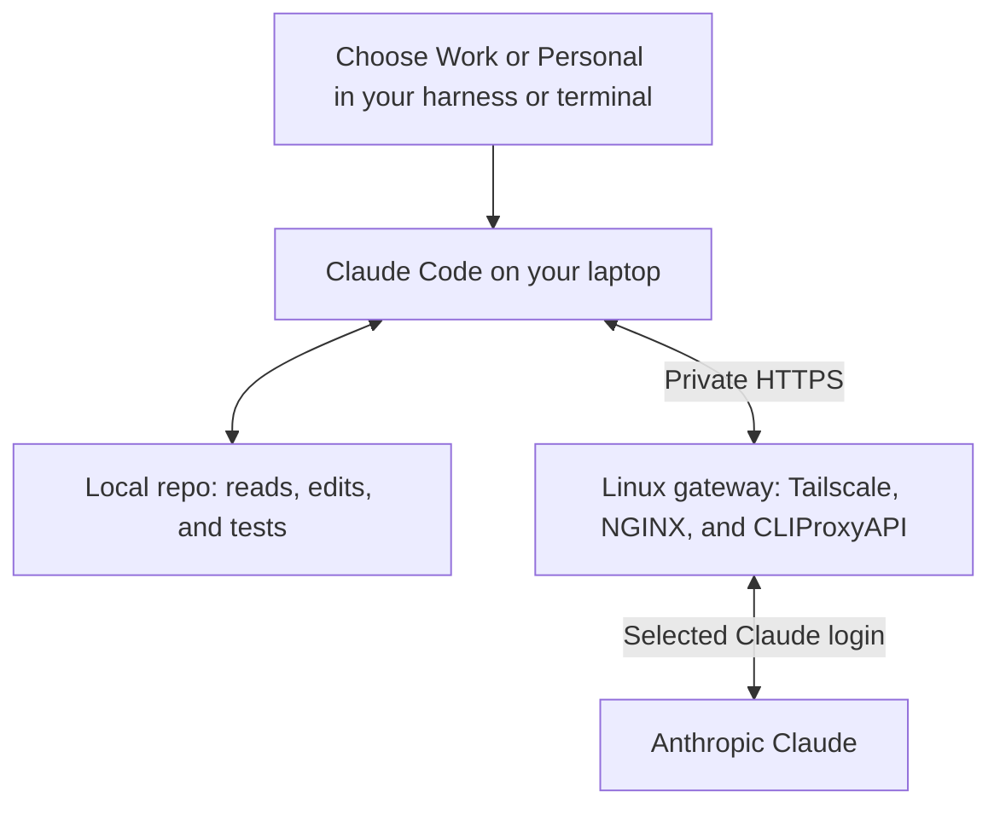

# CloudClaude

Your harness runs Claude Code on each workstation in its local Git checkout. Model requests go through private Tailscale HTTPS to NGINX and CLIProxyAPI on Linux. Each named route uses one Claude subscription login. Each workstation authenticates to the gateway with its own revocable token.

CLIProxyAPI documents Claude OAuth. Anthropic describes subscription OAuth as intended for ordinary use of Claude Code and native Anthropic apps. This private gateway setup is experimental. Verify sign-in and subscription-backed inference with one account before adding more. [CLIProxyAPI OAuth docs](https://help.router-for.me/configuration/provider/claude-code) · [Anthropic authentication guidance](https://code.claude.com/docs/en/legal-and-compliance)

## Architecture



Sign in to each Claude account once through your browser. The gateway saves those logins, checks your laptop's token, and streams responses back using the account you selected.

### Using a Windows laptop as the gateway host

Run Docker and the Linux setup below in Ubuntu 24.04 on WSL 2. Keep `/etc/cloudclaude` on the Linux filesystem. When signing in from the same Windows laptop, first try the browser callback directly through WSL's localhost forwarding. The SSH tunnel in step 1 is for a separate browser host.

Run Tailscale Serve on the Windows host. After the Linux health check passes, check the same loopback endpoint from Windows PowerShell, then start Serve from Windows. Keep the laptop awake and Ubuntu running when the other PC needs the gateway. [WSL localhost forwarding](https://learn.microsoft.com/windows/wsl/networking) · [Tailscale and WSL 2](https://tailscale.com/docs/install/windows/wsl2)

```powershell
curl.exe -fsS -H 'X-CloudClaude-Account: work' http://127.0.0.1:8317/healthz
tailscale serve --bg http://127.0.0.1:8317
```

## 1. Set up your first account on Linux

Use a Linux host with Docker Engine 28 or later, Docker Compose v2, Tailscale, Bash, curl, and jq. Copy the deployment files to the host and run these commands from the directory containing `compose.yaml`. Run the file creation commands only on first setup. [Docker port publishing](https://docs.docker.com/engine/network/port-publishing/)

```bash
sudo install -d -m 0700 /etc/cloudclaude /etc/cloudclaude/oauth /etc/cloudclaude/oauth/work
sudo install -m 0644 ingress.conf /etc/cloudclaude/ingress.conf
sudo install -m 0600 gateway.example.yaml /etc/cloudclaude/work.yaml
sudo nano /etc/cloudclaude/work.yaml
```

Generate two independent 64-character lowercase hexadecimal tokens in your password manager, one per PC. Enter them under `access.api-keys` in the protected file. These are gateway tokens you generate yourself. Keep credentials out of Git, chat, and shell history.

Start the one-time Claude sign-in. The callback port is published on Linux loopback only while this command runs.

```bash
sudo docker compose config --quiet
sudo docker compose pull
sudo docker compose run --rm --no-deps -p 127.0.0.1:54545:54545 gateway-work \
  ./CLIProxyAPI -config /CLIProxyAPI/config.yaml -claude-login -no-browser
```

On your laptop, open another terminal and run `ssh -N -L 127.0.0.1:54545:127.0.0.1:54545 user@linux-host` with your actual SSH destination. Open the login URL printed by CLIProxyAPI in your laptop browser and sign in with the desired Claude subscription. Once Linux reports success, close the tunnel. The gateway keeps this login under `/etc/cloudclaude/oauth/work`. [CLIProxyAPI remote OAuth flow](https://help.router-for.me/hands-on/tutorial-5#_4-add-oauth-authentication)

## 2. Start private HTTPS and test it

```bash
sudo docker compose up -d
sudo docker compose exec -T ingress nginx -t
curl -fsS --retry 15 --retry-connrefused --retry-delay 1 \
  -H 'X-CloudClaude-Account: work' http://127.0.0.1:8317/healthz
```

Run the following where Tailscale is installed. For a dedicated Linux host, run Serve with `sudo`. For WSL, run it in Windows PowerShell as shown above.

```text
tailscale serve --bg http://127.0.0.1:8317
tailscale serve status
tailscale funnel status
```

Allow only your intended devices to reach the Linux host on TCP 443 using tailnet grants. Join both PCs and the Linux host to your tailnet. Confirm the address appears under Serve and is absent from Funnel. Ingress exposes the health, models, Messages, and token-counting routes. Requests with a missing or unknown account selector return HTTP 404. The management API and routine OAuth callback ports stay unexposed. [Tailscale Serve](https://tailscale.com/docs/reference/tailscale-cli/serve) · [Tailscale grants](https://tailscale.com/kb/1324/grants)

Use the HTTPS origin printed by Serve and a model ID available to your subscription. Enter a workstation token when prompted. The smoke test checks authenticated Messages, SSE, token counting, invalid credentials, and management isolation. Repeat after a restart to confirm the saved login survives.

```bash
ORIGIN=https://device.tailnet.ts.net
MODEL=claude-sonnet-4-6
bash smoke-linux.sh "$ORIGIN" "$MODEL" single work
sudo docker compose restart gateway-work
bash smoke-linux.sh "$ORIGIN" "$MODEL" single work
```

## 3. Select the account in your harness

On each workstation, check that `claude --version` works. In your harness, add a Claude Code provider called **Gateway Work** and set its executable to `claude`. Set `CLAUDE_CONFIG_DIR` to a fresh local folder such as `C:\Users\you\.claude_gateway_work` on Windows or `/Users/you/.claude_gateway_work` on macOS. Configure the environment variables below for that provider. [Claude Code gateway setup](https://code.claude.com/docs/en/llm-gateway-connect)

| Variable | Value |
| --- | --- |
| `ANTHROPIC_BASE_URL` | The same Serve HTTPS origin on both PCs, without a trailing slash or `/v1` |
| `ANTHROPIC_AUTH_TOKEN` | The token for this PC, marked **Sensitive** |
| `ANTHROPIC_API_KEY` | Empty, to clear any inherited API key |
| `ANTHROPIC_CUSTOM_HEADERS` | `X-CloudClaude-Account: work` |
| `CLAUDE_CODE_DISABLE_NONESSENTIAL_TRAFFIC` | `1` |

Open a local repo in your harness and start a new session using **Gateway Work** and the tested model. If your harness supports adding a custom model, enter the full model ID. For a Windows-side check, run the following and enter that PC's token at the secure prompt.

```powershell
powershell.exe -NoProfile -ExecutionPolicy RemoteSigned -File .\Test-Workstation.ps1 -BaseUrl https://device.tailnet.ts.net -Model claude-sonnet-4-6 -Account work
```

## Use the gateway from Claude Code in a terminal

Complete the one-time browser sign-in on the Linux gateway first. Set `CLOUDCLAUDE_URL` to the private HTTPS origin. The launcher prompts for that machine's gateway token, then starts Claude in the folder you ran it from.

On Windows, add the CloudClaude folder to your **user PATH**. Set the URL once from CMD and reopen your terminal:

```bat
setx CLOUDCLAUDE_URL "https://device.tailnet.ts.net"
```

Then open any local repo and run this in **CMD or PowerShell**:

```text
claude-gateway.cmd work
claude-gateway.cmd personal
```

In CMD you can omit `.cmd`. On macOS or Linux, add these lines to your shell profile once (for example, `~/.zshrc` on macOS). Use your actual gateway URL and CloudClaude folder:

```bash
export CLOUDCLAUDE_URL=https://device.tailnet.ts.net
export PATH="/path/to/CloudClaude:$PATH"
```

Open a new terminal and run `claude-gateway work` or `claude-gateway personal`. Pass extra Claude Code options after the account, for example `work --version`.

## 4. Add another account

Once Work passes, repeat the setup with `/etc/cloudclaude/personal.yaml`, `/etc/cloudclaude/oauth/personal`, and service `gateway-personal`. Sign in to the intended account in the browser. Start it with `sudo docker compose up -d gateway-personal` and run the smoke test with `single personal`. Compare the Work and Personal Messages trace indices. Each should stay stable when you repeat the check, and the two indices should differ.

Add **Gateway Personal** in your harness with its own local config directory and `ANTHROPIC_CUSTOM_HEADERS=X-CloudClaude-Account: personal`. Pick the desired provider in a new session. For further accounts, copy the Personal service with a new name, config path, and OAuth directory, then add its selector to the account map in `ingress.conf`. Reinstall the ingress config and recreate the ingress service.

## Verify both local workstations

On each PC, run the local proof script with its own fresh path. Use `proof-pc2` on PC2.

```powershell
$proofPath = Join-Path $env:LOCALAPPDATA 'CloudClaude\proof-pc1'
powershell.exe -NoProfile -ExecutionPolicy RemoteSigned -File .\Local-Proof.ps1 -Action New -Path $proofPath
```

Open the printed folder in your harness on that PC. Add the printed `X-CloudClaude-Proof` header on a new line under the provider's existing `ANTHROPIC_CUSTOM_HEADERS`. Start a fresh local session and send the printed prompt. Check the hostname, actual edit, and local test in the session. Run the verifier from a separate PowerShell terminal.

```powershell
powershell.exe -NoProfile -ExecutionPolicy RemoteSigned -File .\Local-Proof.ps1 -Action Verify -Path $proofPath
```

Compare each thread's reported hostname with its verifier output and check that the two Git diffs contain distinct markers. On Linux, match each printed proof ID to a successful Messages request with a trace. Remove the proof header from the provider when done and keep the account header.

```bash
PROOF_ID='<printed proof ID>'
sudo docker compose logs --no-color --no-log-prefix ingress |
  grep -F "proof=$PROOF_ID route=messages status=200 trace=" |
  grep -E 'trace=[0-9]{14}-[0-9a-f]{16}-[0-9a-f-]{36}$'
```

## Revoke a workstation token

Remove the PC's token from every served config. Keep at least one valid token per active route. Recreate the changed services with `sudo docker compose up -d --no-deps --force-recreate gateway-work` and the equivalent command for any other changed gateway. Run the workstation check with `-Mode Revoked` and that route's `-Account`. The old token should return HTTP 401. Rerun the active check on the other PC. Shut down a route before clearing its entire access list because CLIProxyAPI treats an empty list as unconfigured. [Tagged access provider](https://github.com/router-for-me/CLIProxyAPI/blob/v8.1.3/internal/access/config_access/provider.go)

## Logging and storage

CLIProxyAPI commercial mode disables request capture. Gateway Docker logs are disabled. Ingress records bounded metadata for requests marked with a valid proof ID. It strips the proof and account headers before forwarding. The gateway mounts only its server configuration and OAuth directory. Your harness and Claude Code can keep local conversation history. [Tagged middleware wiring](https://github.com/router-for-me/CLIProxyAPI/blob/v8.1.3/internal/api/server.go)
